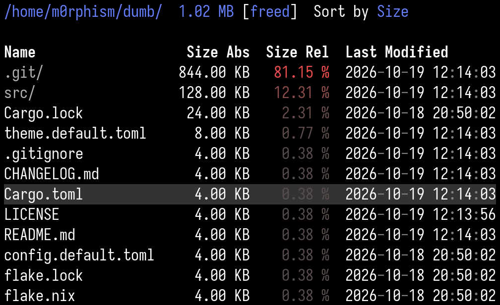

# dumb

[](https://crates.io/crates/dumb)
[](https://github.com/m0rphism/dumb/releases)
[](https://github.com/m0rphism/dumb/actions/workflows/release.yml)
[](LICENSE)

An interactive TUI version of the standard unix `du` program written in Rust.

Recursively scans a directory and presents an interactive file tree that
highlights the disk usage caused by each entry.

Useful for exploring what eats up all that disk space and deleting files in one go.

## Screenshot

<p align="center">
  
</p>

## Core Features

- **Concurrency.**
  Live file tree updates while the directory is being scanned recursively.
  This allows exploring subdirectories before the scan is completed.

- **Proper Size Semantics.**
  The size of a file system entry is displayed as the disk space that would
  become available by deleting the entry.
  In particular, this accounts for hardlinks and uses actual block sizes
  instead of the apparent sizes of files.
  In corner cases or exotic environments (e.g. network mounts) the size may be
  slightly off, see [Limitations](#limitations) for details.

- **Keybindings.**
  Both `vim` keybindings and regular keybindings are supported.
  Press `?` inside the program to display a list of all keybindings.

- **In-Process Deletion.**
  Pressing `d` deletes the currently selected entry (by default with confirmation).
  Deletion is also possible while the deleted directory is still being scanned,
  and the sizes of other directories are adjusted correctly even in the
  presence of hardlinks.

- **TOML config and themes.**
  Many behaviors can be customized and virtually everything can be themed.
  See [`config.default.toml`](config.default.toml) and [`theme.default.toml`](theme.default.toml)
  for all available settings with default values and their documentation.
  If you are missing a config/theme option feel free to open an issue.

- **Error Display.**
  File entries which could not be scanned, e.g. due to missing permissions to access a
  subdirectory, are highlighted in the file tree. The total error count is
  displayed in the header line.
  Pressing `E` displays all errors. Pressing `e` on a file entry displays only
  the errors that occured while scanning this particular entry.

## Limitations

- Unix-only as `std::os::unix::fs::MetadataExt` is used.
- Files deleted outside of the `dumb` process are not detected.
- The `freed` size of an entry is computed from its allocated blocks
  (`st_blocks`, like `du`) and can slightly differ from the space that deleting
  it actually frees:
  - Filesystem metadata (inodes, extent trees, journal) is not counted,
    so sizes are slightly underestimated.
  - On filesystems with reflink, snapshots, or deduplication (e.g. btrfs,
    ZFS), data that is shared between entries is reported as fully
    allocated, but deleting one entry may free none of it.
  - Recently written files may report fewer allocated blocks until the
    filesystem has written their data back.
  - Pseudo filesystems and some network or FUSE mounts (e.g. CIFS/SMB)
    may report zero or approximate block counts.

## Installation

### From `crates.io`

If you have a [rust toolchain](https://rustup.rs/) installed, you can simply run
```sh
cargo install dumb
```
to install `dumb` user-wide into `~/.cargo/bin`.

### From Source

The project has no dependencies beyond a rust toolchain that supports at least
the 2024 Rust edition:
- `cargo build --release` to build an optimized, statically linked binary in
  `./target/release/dumb`;
- `cargo install --path .` to install it user-wide into `~/.cargo/bin`; and
- `cargo run -- [ARGS]` to build and run it in debug mode.

If you are using `nix`, you can run `nix develop` to enter a devshell that
provides a compatible rust toolchain and rust analyzer.

### From Nix Flake

If you are using the `nix` package manager, then you can make use of the
provided [`flake.nix`](flake.nix) file.

To run `dumb` for testing:
```sh
nix run github:m0rphism/dumb         # builds and runs the master branch
nix run github:m0rphism/dumb/v0.1.0  # builds and runs a specific tag
```

To install it permanently:
- If you do not use NixOS, then you can install `dumb` into your nix profile via
  ```sh
  nix profile install github:m0rphism/dumb
  ```
- If you have a flake-based NixOS configuration, then add the input
  ```nix
  dumb = {
    url = "github:m0rphism/dumb";
    inputs.nixpkgs.follows = "nixpkgs";
  };
  ```
  to your flake, and `dumb.packages.x86_64-linux.default` to your package set.

- If you have a classic NixOS configuration, then add the following lines to
  your `configuration.nix` file:
  ```nix
  # Make sure nix flakes are enabled
  nix.settings.experimental-features = [ "nix-command" "flakes" ];
  # Add the `dumb` flake as a package
  environment.systemPackages = [
    (builtins.getFlake "github:m0rphism/dumb").packages.${pkgs.system}.default
  ];
  ```

## Contributing

I am generally open for contributions, but ask that you adhere to a single rule:

> **Issues and pull request must start with at least one human written paragraph,
> and AI generated text and code must be clearly highlighted as such.**

Pure slop issues/pull requests might be closed without any response.

